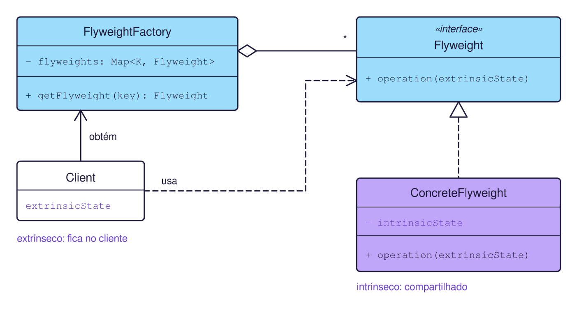

# Seminário: Padrão de Projeto Flyweight

Material de apoio do seminário de **Padrões de Projeto** apresentado por **Fabio, Douglas e João** na disciplina Análise e Projeto Orientado a Objetos do IFSP — Câmpus São Carlos.

Repositório: https://github.com/codesfb/flyweight

Apresentação completa: [`docs/Flyweight_slides.pdf`](docs/Flyweight_slides.pdf)

## Diagramas

### Estrutura geral do padrão



O diagrama mostra a divisão principal:

- o **Flyweight** define a interface dos objetos compartilháveis;
- o **ConcreteFlyweight** guarda o estado intrínseco;
- a **FlyweightFactory** mantém os objetos já criados e devolve o mesmo objeto quando a chave se repete;
- o **Client** fornece o estado extrínseco e o utiliza durante a operação.

### Implementação com Flyweight da floresta

.png)

Neste projeto, `TipoArvore` é o objeto compartilhado, `FabricaArvores` controla o compartilhamento e `Arvore` representa cada ocorrência individual na floresta.

### Implementação sem Flyweight



Nesta versão, cada objeto `Arvore` possui sua própria espécie e cópia da textura. O custo cresce diretamente com o número de árvores.

---

## O que é o Flyweight?

**Flyweight** é um padrão de projeto estrutural cujo objetivo é reduzir o consumo de memória em sistemas que precisam criar muitos objetos semelhantes. Em vez de repetir o mesmo estado em todas as instâncias, o padrão separa os dados em duas categorias:

- **Estado intrínseco:** dados que podem ser compartilhados por vários objetos. São armazenados no objeto Flyweight e devem ser imutáveis.
- **Estado extrínseco:** dados diferentes em cada objeto. São fornecidos pelo cliente como parâmetros ou ficam armazenados na instância que representa a ocorrência.

A **fábrica** mantém uma tabela de Flyweights existentes, normalmente um `Map`. Quando o cliente solicita um Flyweight já conhecido, a fábrica devolve a instância existente. Somente uma nova instância é criada quando o estado intrínseco ainda não foi registrado.

## Problema que motiva o padrão

Considere um jogo que renderiza uma floresta com 10.000 árvores. Se cada objeto guardar:

- posição `x`;
- posição `y`;
- espécie;
- cor;
- textura completa;

mesmo objetos da mesma espécie repetirão grande parte dos dados. Uma textura RGBA de 64 × 64 pixels ocupa:

```text
64 × 64 × 4 bytes = 16.384 bytes
```

Com 10.000 cópias, o custo teórico dos buffers seria:

```text
10.000 × 16.384 bytes = 163.840.000 bytes
≈ 156 MiB
```

Esse espaço não precisa ser repetido. Como as características visuais podem ser compartilhadas, a memória deve ser usada principalmente para representar a posição e a identidade de cada árvore.

## Como o Flyweight resolve o problema

No exemplo da floresta:

| Informação | Tipo de estado | Local |
|---|---|---|
| Espécie | Intrínseco | `TipoArvore` |
| Textura | Intrínseco | `TipoArvore` |
| Cor | Intrínseco | `TipoArvore` |
| Posição X | Extrínseco | `Arvore` |
| Posição Y | Extrínseco | `Arvore` |
| Escala | Extrínseco | `Arvore` |

A aplicação continua tendo 10.000 objetos `Arvore`, mas todos podem compartilhar poucos objetos `TipoArvore`. Quando uma textura é solicitada pela fábrica pela primeira vez, ela é criada e armazenada. Nas próximas solicitações da mesma espécie, a mesma instância é retornada.

## Funcionamento da estrutura

1. O cliente fornece a chave do estado intrínseco, como o nome da espécie.
2. `FlyweightFactory` pesquisa essa chave em um `Map`.
3. Se encontrar um objeto existente, devolve-o.
4. Caso contrário, cria um `ConcreteFlyweight`, guarda-o no mapa e o devolve.
5. O cliente combina esse objeto compartilhado com o estado extrínseco da ocorrência.

## Participantes

| Participante | Responsabilidade |
|---|---|
| `Flyweight` | Declara as operações que recebem estado extrínseco. |
| `ConcreteFlyweight` | Implementa a interface e mantém o estado intrínseco compartilhado. |
| `FlyweightFactory` | Cria, mantém e fornece instâncias compartilhadas. |
| `Client` | Mantém ou calcula o estado extrínseco e usa os Flyweights. |

## Implementação do exemplo sem Flyweight

Nesta versão, cada árvore contém os seus próprios dados visuales.

```java
import java.util.Arrays;

public class Arvore {
    private int x, y;
    private String especie;
    private byte[] textura;

    public Arvore(int x, int y, String especie, byte[] pixels) {
        this.x = x;
        this.y = y;
        this.especie = especie;
        this.textura = Arrays.copyOf(pixels, pixels.length);
    }
}
```

```java
import java.util.ArrayList;
import java.util.List;

public class Main {
    public static void main(String[] args) {
        byte[] pixels = new byte[64 * 64 * 4];
        List<Arvore> arvores = new ArrayList<>();

        for (int i = 0; i < 10000; i++) {
            arvores.add(new Arvore(i, i, "Carvalho", pixels));
        }
    }
}
```

Mesmo que `pixels` tenha sido passado para todas as árvores, o construtor cria uma cópia diferente para cada instância. Com isso, existirão 10.000 buffers de textura.

## Implementação do exemplo com Flyweight

### Tipo de árvore — estado intrínseco

```java
public class TipoArvore {
    private final String especie;
    private final byte[] textura;

    public TipoArvore(String especie, byte[] pixels) {
        this.especie = especie;
        this.textura = pixels;
    }
}
```

Os campos são `final` para evitar alterações depois da criação. Compartilhar um objeto mutável pode fazer uma alteração afetar todas as ocorrências.

### Fábrica — compartilhamento

```java
import java.util.HashMap;
import java.util.Map;

public class FabricaArvores {
    private static final Map<String, TipoArvore> tipos = new HashMap<>();

    public static TipoArvore obterTipo(String especie, byte[] pixels) {
        if (!tipos.containsKey(especie)) {
            tipos.put(especie, new TipoArvore(especie, pixels));
        }
        return tipos.get(especie);
    }
}
```

Em uma aplicação concorrente, `HashMap` não é a escolha adequada sem sincronização. Nesse caso, seria possível usar `ConcurrentHashMap` ou outra estratégia thread-safe.

### Árvore — estado extrínseco

```java
public class Arvore {
    private int x;
    private int y;
    private TipoArvore tipo;

    public Arvore(int x, int y, TipoArvore tipo) {
        this.x = x;
        this.y = y;
        this.tipo = tipo;
    }
}
```

### Aplicação

```java
import java.util.ArrayList;
import java.util.List;

public class Main {
    public static void main(String[] args) {
        byte[] pixels = new byte[64 * 64 * 4];
        TipoArvore tipo = FabricaArvores.obterTipo("Carvalho", pixels);

        List<Arvore> arvores = new ArrayList<>();

        for (int i = 0; i < 10000; i++) {
            arvores.add(new Arvore(i, i, tipo));
        }
    }
}
```

## Comparação sem e com Flyweight

| Aspecto | Sem Flyweight | Com Flyweight |
|---|---:|---:|
| Objetos de árvore | 10.000 | 10.000 |
| Espécies | 1 | 1 |
| Objetos de tipos compartilhados | 0 | 1 |
| Buffers de textura iguais | 10.000 | 1 |
| Posições individuais | 10.000 | 10.000 |

No exemplo teórico, os 10.000 buffers sem compartilhamento ocupam aproximadamente 156 MiB. Com uma única textura compartilhada, o custo correspondente passa a ser próximo de 16 KiB para esse buffer, além da memória usada pelas 10.000 posições e referências. Os números exatos variam com a implementação da JVM, tamanho dos objetos e quantidade de espécies.

## Frameworks e usos reais

### Java String Pool

O mecanismo de interning de Strings é um exemplo conhecido de reutilização semelhante ao Flyweight:

```java
String texto1 = new String("Flyweight");
String texto2 = new String("Flyweight");

System.out.println(texto1 == texto2); // false

String texto3 = texto1.intern();
String texto4 = texto2.intern();

System.out.println(texto3 == texto4); // true
```

O operador `==` compara referências, não o conteúdo. O método `intern()` localiza ou registra uma representação compartilhada da String no pool da JVM.

### Java Swing

Bibliotecas de interface gráfica, como o Java Swing, podem reutilizar componentes de renderização e objetos de célula em estruturas como tabelas e listas. Cada elemento visual precisa apenas receber informações próprias, como linha, coluna ou estado, enquanto objetos pesados de renderização são reutilizados.

### Editores de texto

Editores como o VS Code precisam representar muitos caracteres. A posição e os atributos individuais podem variar, enquanto fontes, estilos e recursos visuais podem ser reutilizados. Esse cenário ilustra a separação entre dados exclusivos e dados compartilháveis.

As implementações internas de frameworks podem ser mais complexas e não são, necessariamente, uma aplicação direta e literal do diagrama clássico.

## Vantagens e desvantagens

### Vantagens

- reduz a memória usada por objetos com estado intrínseco repetido;
- diminui o número de objetos pesados;
- permite representar grandes coleções sem duplicar dados;
- separa dados compartilháveis dos dados próprios de cada ocorrência.

### Desvantagens

- aumenta a complexidade do modelo;
- exige identificar corretamente estado intrínseco e extrínseco;
- o Flyweight compartilhado precisa ser imutável;
- o estado extrínseco pode aumentar o custo de processamento;
- uma fábrica concorrente precisa ser thread-safe;
- pode tornar o código menos simples em cenários pequenos.

## Quando usar

Use Flyweight quando:

- existem milhares ou milhões de objetos;
- uma parte significativa do estado se repete;
- o consumo de memória é um gargalo confirmado;
- o estado único pode ser armazenado fora dos objetos.

Evite Flyweight quando:

- existirem poucos objetos;
- os estados forem majoritariamente diferentes;
- o ganho de memória não justificar a complexidade;
- o objeto Flyweight precisar mudar de forma independente.

Como em qualquer otimização, é importante medir o uso real antes e depois da alteração.

## Exercício proposto

### Cenário

Desenvolver um jogo que represente diversas chamas no mapa.

### Requisitos

O jogo deverá possuir três tipos de chama:

| Tipo | Aparência | Identificação |
|---|---|---|
| Fogo comum | Alaranjado | `FIRE` |
| Fogo mágico | Azul | `MAGIC_FIRE` |
| Fogo tóxico | Verde | `TOXIC_FIRE` |

Cada chama deve possuir suas próprias coordenadas `X` e `Y` no mapa.

### Resultado esperado

Implementar uma solução em que:

- a aparência compartilhada não seja duplicada para cada chama;
- posição e coordenadas permaneçam individuais;
- uma fábrica reutilize os tipos de fogo existentes;
- seja possível criar quantidades variadas de chamas sem criar uma aparência nova para cada instância.

O enunciado permanece nesta branch. A implementação resolvida, com código e UML, está na branch [`exercise-solution`](https://github.com/codesfb/flyweight/tree/exercise-solution).

## Sobre este repositório

### Estrutura

```text
flyweight/
├── pom.xml
├── README.md
├── docs/
│   ├── checklist.md
│   └── Flyweight_slides.pdf
├── diagrams/
│   ├── Flyweight.png
│   ├── Flyweight (1).png
│   ├── uml_antes_sem_flyweight.svg
│   └── uml_flyweight_chamas_azul.svg  # na branch exercise-solution
└── src/
    └── main/
        └── java/
            ├── examples/
            │   ├── EspecieArvore.java
            │   ├── withflyweight/
            │   └── withoutflyweight/
            └── exercices/             # na branch exercise-solution
```

Os exemplos da floresta estão implementados em classes Java. A versão sem Flyweight cria uma cópia do buffer de textura em cada `Arvore`; a versão com Flyweight usa `FabricaArvores` para compartilhar um `TipoArvore` por espécie. Ambas criam 10.000 árvores e apresentam uma estimativa teórica da memória usada pelos buffers.

### Java e Maven

O projeto usa Maven. Atualmente, `pom.xml` declara Java 27 como versão de compilação. O ambiente utilizado para compilar deve possuir uma JDK compatível.

Os exemplos podem ser executados separadamente:

```bash
mvn -q package
java -cp target/classes examples.withoutflyweight.Main
java -cp target/classes examples.withflyweight.Main
```

O exercício das chamas e sua implementação estão organizados em branches distintas:

```bash
# Enunciado, na branch principal
git switch main

# Resolução completa
git switch exercise-solution
```

## Referências

- Gamma, Helm, Johnson e Vlissides. *Design Patterns: Elements of Reusable Object-Oriented Software*. Addison-Wesley.
- Refactoring Guru. *Flyweight*. https://refactoring.guru/design-patterns/flyweight
- Oracle. *Java SE API Specification* — documentação sobre `String.intern()`.
- Material de slides produzido para o seminário: [`Flyweight_slides.pdf`](docs/Flyweight_slides.pdf).
